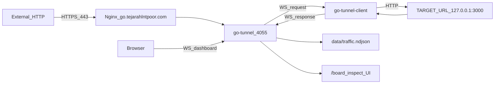

# Architecture

## Components



## Processes (PM2)

| Name | Script | Role |
|------|--------|------|
| `go-tunnel` | `server.js` | HTTP board, API, WS relay, history |
| `go-tunnel-client` | `client.js` | WS client → forwards to `TARGET_URL` |

## Path routing

| Path pattern | Handler | Tunneled? |
|--------------|---------|-----------|
| `/board`, `/dashboard`, `/inspect`, `/` | HTML inspect board | No |
| `/api/*` | JSON APIs | No |
| `/ws`, `/ws/dashboard` | WebSocket | No |
| Everything else | Tunnel → agent → upstream | Yes |

## Traffic record schema

Each captured request (ngrok-aligned visitor enrichment):

```json
{
  "id": "uuid",
  "at": "ISO-8601",
  "method": "GET",
  "path": "/health",
  "ip": "45.96.65.26",
  "ipChain": ["45.96.65.26", "127.0.0.1"],
  "geo": {
    "city": "Riyadh",
    "country": "Saudi Arabia",
    "country_code": "SA",
    "latitude": "24.71",
    "longitude": "46.67",
    "radius": "",
    "subdivision": "Riyadh Region"
  },
  "userAgent": {
    "raw": "Mozilla/5.0 …",
    "name": "Chrome",
    "version": "120.0.0.0",
    "os": "macOS",
    "os_version": "10.15.7",
    "device": "Desktop",
    "is_mobile": false,
    "is_tablet": false,
    "is_desktop": true,
    "is_bot": false,
    "url": ""
  },
  "visitor": {
    "conn": {
      "client_ip": "45.96.65.26",
      "client_port": 54321,
      "server_ip": "127.0.0.1",
      "server_port": 4055,
      "server_region": "",
      "ts": { "start": "…" },
      "bytes_in": 0,
      "bytes_out": 128,
      "geo": { "city": "…", "country": "…", "country_code": "SA", "latitude": "…", "longitude": "…", "subdivision": "…" },
      "client_ip_intel": {
        "categories": ["hosting"],
        "is_on_blocklist": false,
        "is_tor_node": false,
        "as": { "number": 15169, "organization": "GOOGLE" },
        "geo": {
          "location": {
            "city": "…",
            "continent": "Asia",
            "country": "…",
            "country_code": "SA",
            "is_eu": false,
            "latitude": "…",
            "longitude": "…",
            "postal_code": "…",
            "subdivision": "…",
            "timezone": "Asia/Riyadh"
          },
          "registered_location": { }
        },
        "isp": "…",
        "org": "…",
        "enrich_status": "ok",
        "enrich_source": "ip-api"
      }
    },
    "req": {
      "method": "GET",
      "host": "go.tejarahlntpoor.com",
      "version": "HTTP/1.1",
      "content_type": "",
      "url": "https://go.tejarahlntpoor.com/health",
      "url_path": "/health",
      "url_query": "",
      "url_query_params": {},
      "url_scheme": "https",
      "user_agent": { },
      "cookies": {},
      "accept_language": "en-US",
      "referer": "",
      "origin": ""
    }
  },
  "reqHeaders": {},
  "reqBody": "",
  "reqBodyBase64": "",
  "reqBytes": 0,
  "resBytes": 128,
  "status": 200,
  "resHeaders": {},
  "resBody": "...",
  "durationMs": 12,
  "tunneled": true,
  "error": null,
  "replayOf": null
}
```

Geo/ASN enrichment runs asynchronously after the request is logged (does not add tunnel latency). Disable with `GEO_LOOKUP=0`.

## Persistence

- **SQLite:** `data/visits.db` — append-only payload visit history
- **Boot:** one-time import from legacy `data/traffic.ndjson` (payload `/probe` rows only) if DB is empty
- **No delete:** history cannot be cleared via API or board UI

## What gets tracked

| Path | Stored in history? |
|------|-------------------|
| `GET /probe` (payload link) | Yes |
| `/probe.json`, `/board`, `/api/*`, `/ws` | No |
| Tunneled paths (`/health`, etc.) | No |

## Environment variables

### server.js (`go-tunnel`)

| Var | Default | Description |
|-----|---------|-------------|
| `PORT` | `4055` | Listen address |
| `LIST_LIMIT` | `200` | Default API page size |
| `DATA_DIR` | `./data` | Persistence directory |
| `SQLITE_PATH` | `{DATA_DIR}/visits.db` | SQLite database file |
| `PAYLOAD_PATH` | `/probe` | Path recorded as payload visits |
| `PUBLIC_URL` | `https://go.tejarahlntpoor.com` | Shown on board |
| `TARGET_URL` | `http://127.0.0.1:3000` | Shown on board (forward target) |
| `GEO_LOOKUP` | `1` | Set `0` to skip IP geo/ASN lookup |
| `GEO_CACHE_TTL_MS` | `21600000` | In-memory geo cache TTL (6h) |
| `GEO_LOOKUP_TIMEOUT_MS` | `2500` | Max wait for ip-api.com |
| `SERVER_REGION` | — | Optional PoP label (`conn.server_region`) |

### client.js (`go-tunnel-client`)

| Var | Default | Description |
|-----|---------|-------------|
| `GO_WS` | `wss://go.tejarahlntpoor.com/ws` | Tunnel WebSocket |
| `TARGET_URL` | `http://127.0.0.1:3000` | Upstream HTTP base |
| `ECHO` | — | If `1` and no TARGET_URL, echo JSON |
